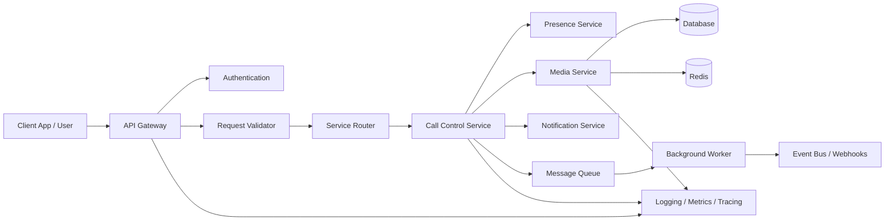

# Virtual Calling Architecture Demo

This repository demonstrates a simple virtual calling system architecture and includes a working Node.js example that models the flow of a call from request validation through session creation, media activation, notification generation, and async background processing.

## Features

- API gateway flow for incoming requests
- authentication and request validation
- call control lifecycle management
- media service simulation for live streams
- notification service integration
- message queue processing for async events
- observability and deployment overview
- Mermaid diagrams for architecture documentation

## Project structure

```text
.
├── README.md
├── architecture.md
├── package.json
├── .gitignore
├── examples/
│   └── virtual-calling-demo.js
└── docs/
    └── deployment-view.md
```

## Quick start

```bash
npm install
npm start
```

## Example output

```bash
node examples/virtual-calling-demo.js
```

This will simulate a call lifecycle and print a JSON payload resembling a production virtual calling workflow.

## Architecture overview



## Repository goals

- show a clear virtual calling architecture
- document a deployment-oriented design
- provide a working code sample for learning and prototypes
- support extension to WebRTC, SIP, or cloud telephony providers

## Tech stack examples

- Frontend: React, Flutter, Web SDKs
- Backend: Node.js, Python, Go
- Media: WebRTC, SIP, Twilio, Janus, Kurento
- Messaging: Kafka, RabbitMQ, SQS
- Database: PostgreSQL, MySQL, MongoDB
- Cache: Redis
- Monitoring: Prometheus, Grafana, OpenTelemetry

## License

MIT
