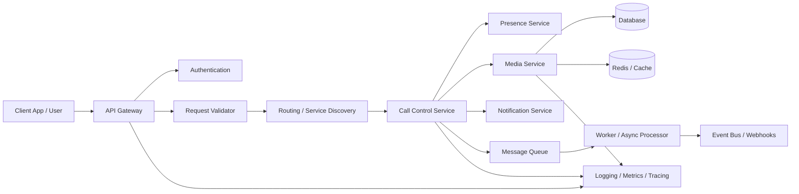

# Virtual Calling Architecture

A simple architecture for a virtual calling application or backend communication system.

## Overview

This project presents a clean, modular architecture for:
- client-to-service communication
- call/session management
- media handling
- notifications
- observability and scaling

## High-Level Architecture

## Components

### 1. Client App / User
The interface where users initiate, accept, or manage calls.

### 2. API Gateway
Routes requests to internal services and provides:
- load balancing
- rate limiting
- authentication enforcement
- request aggregation

### 3. Authentication
Verifies user identity and enforces authorization tokens and session checks.

### 4. Request Validator
Checks the payload, headers, and request constraints before forwarding.

### 5. Routing / Service Discovery
Maps user requests to the correct backend service instance.

### 6. Call Control Service
Manages:
- call initiation
- session state
- call transfers
- disconnect and timeout events

### 7. Presence Service
Tracks online/offline and active/inactive states.

### 8. Media Service
Handles:
- audio/video streams
- connection setup
- transcoding if required
- media server integration

### 9. Notification Service
Sends:
- SMS
- email
- push notifications
- webhook-based alerts

### 10. Database
Stores:
- user profiles
- sessions
- call metadata
- activity logs

### 11. Redis / Cache
Improves performance by caching:
- session state
- route information
- user presence
- recent call metadata

### 12. Message Queue
Handles asynchronous tasks such as:
- call logs
- notifications
- webhook retries
- event fanout

### 13. Background Worker
Processes asynchronous jobs from the queue.

### 14. Observability
Collects:
- logs
- metrics
- traces
- health checks

## Typical Request Flow
1. User initiates a virtual call
2. API Gateway authenticates and validates the request
3. Routing layer chooses the correct service
4. Call Control Service creates or updates the session
5. Media Service manages the connection
6. Background jobs process notifications and logs
7. Observability tools monitor performance and failures

## Example Tech Stack
- Frontend: React / Flutter / Web
- Backend: Node.js / Python / Go
- API: REST / gRPC
- Media: WebRTC / SIP / Twilio / Janus / Kurento
- Messaging: RabbitMQ / Kafka / SQS
- Database: PostgreSQL / MySQL / MongoDB
- Cache: Redis
- Monitoring: Prometheus / Grafana / OpenTelemetry

## Use Cases
- customer support calling
- telehealth sessions
- virtual meeting infrastructure
- call center orchestration
- real-time collaborative communication

## Notes
This is intentionally a simplified architecture to make the foundational design easy to understand and extend.
