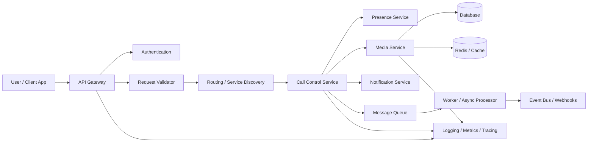

# Virtual Calling Architecture

This document describes a simple virtual calling architecture for a modern communication system.

## Overview

The system is composed of a set of modular components that work together to handle user sessions, call routing, media traffic, notifications, and observability.

## Architecture

## Component Responsibilities

### API Gateway
Provides routing, security, and rate limiting.

### Authentication
Validates users and authorizes requests.

### Request Validator
Ensures the request format and payload are valid before processing.

### Routing / Service Discovery
Finds the service responsible for the incoming communication request.

### Call Control Service
Handles connection lifecycle, session updates, and call operations.

### Presence Service
Tracks whether a user is online or offline and available for communication.

### Media Service
Manages real-time audio and video streams.

### Notification Service
Sends SMS, email, push, or webhook-notifications based on call events.

### Message Queue
Handles asynchronous tasks and decouples heavy operations.

### Background Worker
Executes jobs such as notifications, logging, and event processing.

### Database and Cache
Store persistent and ephemeral data for sessions, users, and state.

### Observability
Collects logs, traces, and metrics to monitor the health of the system.

## Typical Flow

1. User initiates a call from the app.
2. Gateway authenticates and validates the request.
3. Router directs the request to the correct service.
4. Call Control Service starts or updates the session.
5. Media Service handles the connection.
6. Queue-driven workers handle notifications and downstream processing.
7. Observability layer captures health and performance data.

## Best Practices

- separate stateless services from stateful services
- use cache for fast access to presence/session state
- move long-running tasks into queues and workers
- monitor call failures and latency with metrics and tracing
- secure media endpoints with authentication and transport protections

## Example Stack

- Frontend: React, Flutter, Web
- Backend: Node.js, Python, Go
- Messaging: RabbitMQ, Kafka, SQS
- Database: PostgreSQL, MySQL, MongoDB
- Cache: Redis
- Media: WebRTC, SIP, Twilio, Janus, Kurento
- Observability: Prometheus, Grafana, OpenTelemetry
