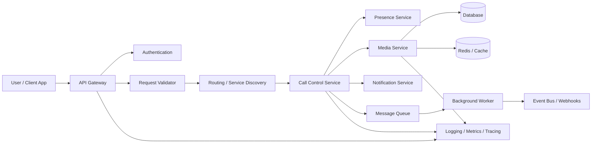
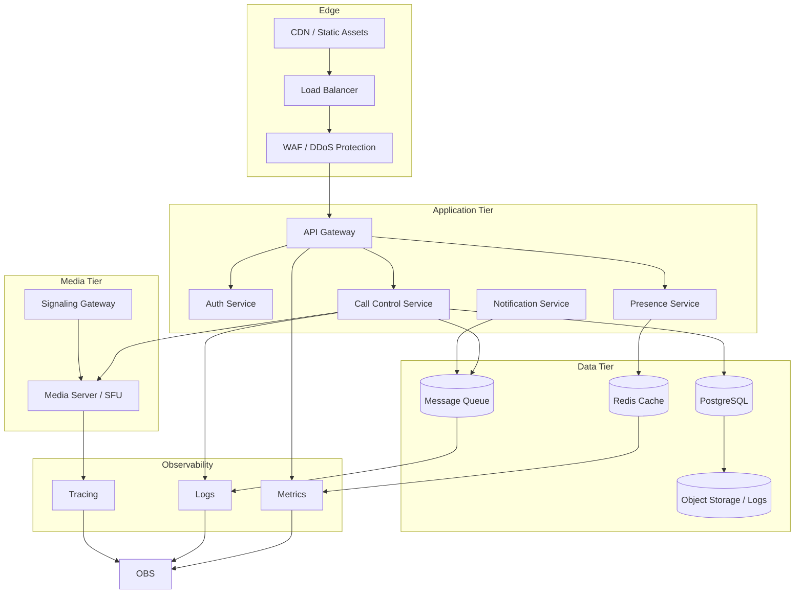

# Virtual Calling Architecture

This document explains a simple but realistic virtual calling architecture for a communication platform. It is intended to help developers and architects understand the flow from client request to session establishment, media handling, notifications, and monitoring.

## Overview

The system is composed of several layers:

- edge and request handling
- auth and validation
- call orchestration
- media processing
- presence and notifications
- background job processing
- storage and observability

## Logical architecture

## Deployment architecture

## Component responsibilities

### API Gateway
- routes incoming requests
- applies rate limiting and quotas
- terminates TLS and enforces security policies

### Authentication
- verifies identity and token validity
- checks authorization and user access

### Request Validator
- validates request payloads and headers
- rejects malformed or incomplete calls

### Call Control Service
- manages dialing, ringing, connection, and hangup logic
- updates session state and call metadata

### Presence Service
- tracks user online status and reachability
- supports queue routing and availability checks

### Media Service
- handles the actual voice and video streams
- manages real-time media routing with WebRTC or SIP backends

### Notification Service
- sends SMS, email, push, or webhook notifications
- reacts to state changes such as call started or missed

### Database and cache
- stores user profiles, sessions, and audit logs
- caches presence and hotspot session data for low latency

### Queue and workers
- offload heavy async processing
- support retries, fanout, and failure recovery

### Observability
- tracks throughput, latency, and call quality metrics
- records logs and traces for debugging and incident response

## Typical flow

1. Client initiates a call request.
2. API Gateway authorizes and validates the request.
3. Router selects the target service.
4. Call Control creates and updates session state.
5. Media Service establishes or manages the connection.
6. Queue workers process async actions like notifications and job fanout.
7. Logs, traces, and metrics are stored for monitoring.

## Best practices

- separate business logic from media processing
- horizontal scale application and media nodes independently
- keep session state compact and cache-friendly
- use asynchronous queues for non-critical workflows
- treat latency and call quality as first-class monitoring signals

## Example stack

- Frontend: React, Flutter, Web
- Backend: Node.js, Python, Go
- Media: WebRTC, SIP, Twilio, Janus, Kurento
- Messaging: RabbitMQ, Kafka, SQS
- Database: PostgreSQL, MySQL, MongoDB
- Cache: Redis
- Monitoring: Prometheus, Grafana, OpenTelemetry

## Notes

This is intentionally a simplified architecture designed to be clear, extensible, and easy to adapt for a production system.
