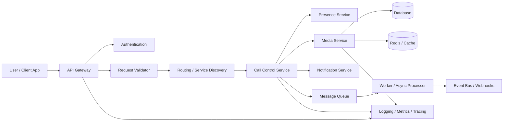
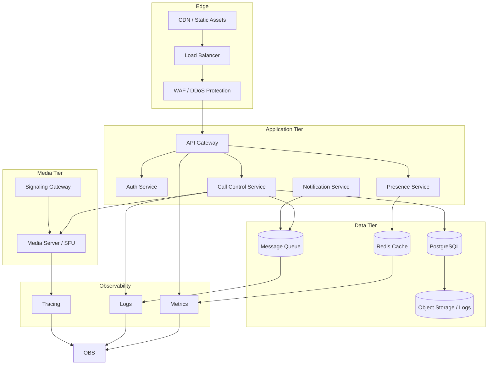

# Virtual Calling Architecture

This document describes a simple virtual calling architecture for a modern communication system.

## Overview

The system is composed of a set of modular components that work together to handle user sessions, call routing, media traffic, notifications, and observability.

## Architecture

## Deployment Architecture

The system can be deployed as a set of independently scalable layers:

## Deployment Layers

### Edge layer
- ingress and traffic protection
- manages TLS termination, WAF rules, and rate limits
- can be deployed with a load balancer or Kubernetes ingress

### Application layer
- stateless services run in containers or serverless functions
- autoscaling is based on request throughput, CPU, and queue depth
- application code is isolated from media-intensive work

### Media layer
- dedicated media servers process real-time communication streams
- signaling traffic is separated from media flow to improve reliability
- media nodes can be scaled independently from app nodes

### Data layer
- PostgreSQL holds persistent business and session metadata
- Redis provides low-latency state and presence lookups
- queues support retries and asynchronous notification workflows

## Scalability and Reliability

- run multiple application replicas behind a load balancer
- separate APIs and media traffic to avoid resource contention
- use health checks and rolling updates for safer deployments
- keep queue-based processing for notifications and event fanout
- monitor call failure, session drops, and media latency continuously

## Security and Operations

- secure all public endpoints with TLS, authentication, and access controls
- isolate sensitive data in the database and secret management system
- store logs and telemetry in centralized monitoring tools
- alert on queue backlogs, connection failures, and degraded media quality

## Component Responsibilities

### API Gateway
Provides routing, security, and rate limiting.

### Authentication
Validates users and authorizes requests.

### Request Validator
Ensures the request format and payload are valid before processing.

### Routing / Service Discovery
Finds the service responsible for the incoming communication request.

### Call Control Service
Handles connection lifecycle, session updates, and call operations.

### Presence Service
Tracks whether a user is online or offline and available for communication.

### Media Service
Manages real-time audio and video streams.

### Notification Service
Sends SMS, email, push, or webhook-notifications based on call events.

### Message Queue
Handles asynchronous tasks and decouples heavy operations.

### Background Worker
Executes jobs such as notifications, logging, and event processing.

### Database and Cache
Store persistent and ephemeral data for sessions, users, and state.

### Observability
Collects logs, traces, and metrics to monitor the health of the system.

## Typical Flow

1. User initiates a call from the app.
2. Gateway authenticates and validates the request.
3. Router directs the request to the correct service.
4. Call Control Service starts or updates the session.
5. Media Service handles the connection.
6. Queue-driven workers handle notifications and downstream processing.
7. Observability layer captures health and performance data.

## Best Practices

- separate stateless services from stateful services
- use cache for fast access to presence/session state
- move long-running tasks into queues and workers
- monitor call failures and latency with metrics and tracing
- secure media endpoints with authentication and transport protections

## Example Stack

- Frontend: React, Flutter, Web
- Backend: Node.js, Python, Go
- Messaging: RabbitMQ, Kafka, SQS
- Database: PostgreSQL, MySQL, MongoDB
- Cache: Redis
- Media: WebRTC, SIP, Twilio, Janus, Kurento
- Observability: Prometheus, Grafana, OpenTelemetry

## Notes
This architecture is intentionally simplified to make the deployment model understandable and easy to extend in a real production environment.

---

This deployment view addresses the repository issue by documenting the edge, application, media, and data layers along with scalability, resilience, and observability considerations.
