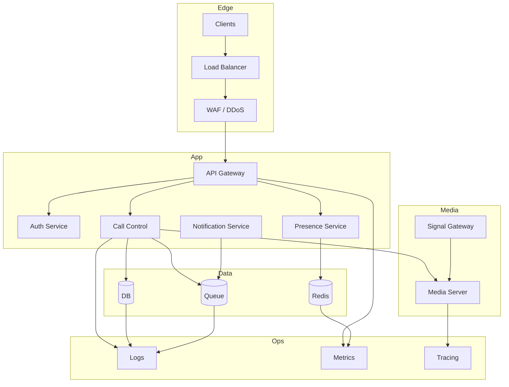

# Deployment View

This document focuses specifically on how the virtual calling architecture can be deployed in a real environment.

## Deployment model

The system should be split into independent layers:

- edge layer for traffic control and protection
- app layer for business logic and API processing
- media layer for real-time traffic
- data layer for persistence and queue processing

## Deployment diagram

## Operational recommendations

- run API services behind autoscaling groups or Kubernetes deployments
- keep websocket or signaling traffic separate from large media streams
- coordinate media scaling based on CPU, packet loss, and jitter
- use health checks and rolling deploys for safer runtime changes
- maintain data backups and queue replay for fault tolerance

## Production concerns

- secure APIs and signaling channels with identity checks
- isolate call state and media path from non-call workloads
- monitor call quality metrics continuously
- add retries for notification and webhook delivery
- preserve audit records for support investigations
